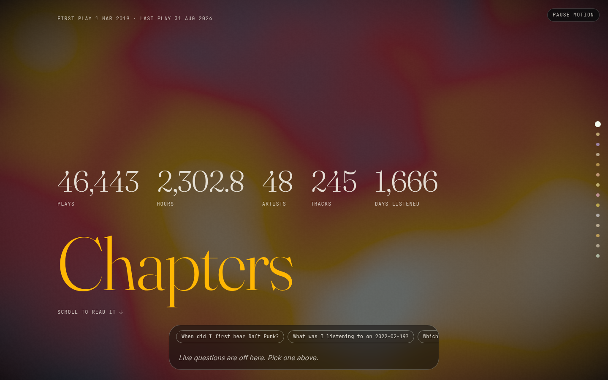
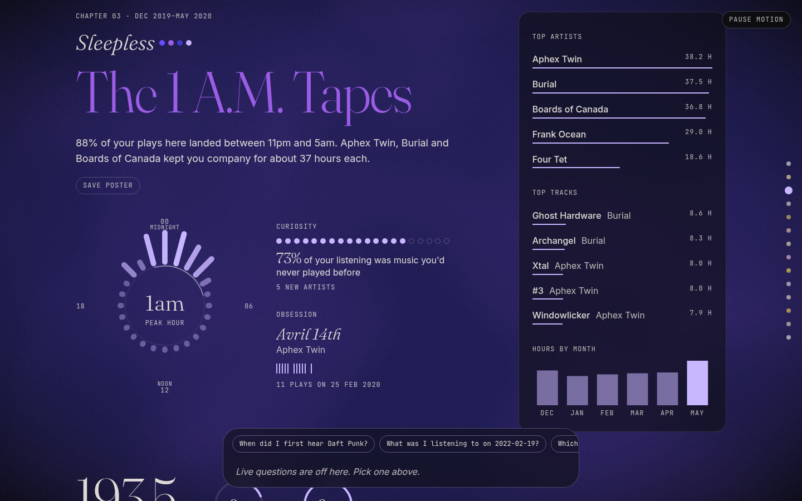
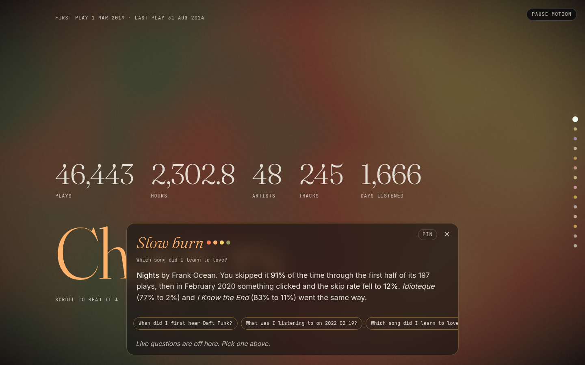
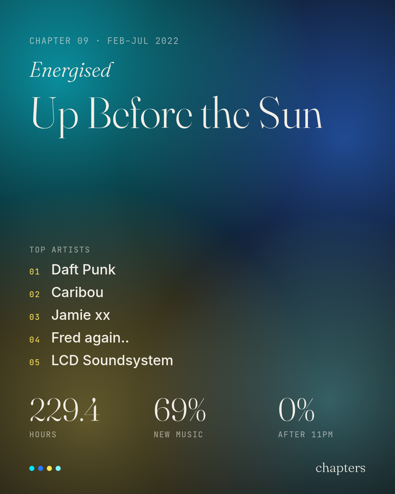
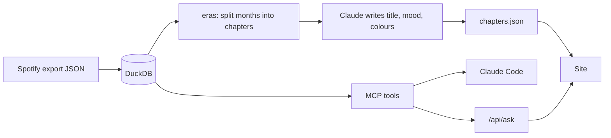

# chapters

Your Spotify listening history, split into named chapters you can scroll through and ask questions about.



| A chapter, with its clock | An answer, with the page recoloured | A poster saved from a chapter |
| --- | --- | --- |
|  |  |  |

Spotify's "Extended Streaming History" export is every play you've ever made:
timestamp, how long you listened, whether you skipped, what device. This loads
it into DuckDB, works out where your taste changed, has Claude name each
stretch, and turns the result into a scrolling page. The same data is exposed
to Claude as MCP tools, so you can ask things like *"what was I into the month
I moved?"* or *"which songs did I skip constantly in 2022 but love now?"*

## What's interesting here

- **An MCP server with typed tools over 5 years of plays.** Claude Code and the
  site's Ask box call the same tools, so there is one set of queries to test.
- **Chapter detection with no randomness.** The history is cut where a month
  sounds least like the three before it (cosine similarity of minutes per
  artist), enough cuts for a chapter every six months or so, never shorter than
  two months or longer than twelve. Same history in, same chapters out.
- **Colours picked by the model, drawn by a hand-written WebGL shader.** Claude
  chooses four colours per chapter; the background blends to them as you scroll.
- **An Ask box whose answers recolour the page.** Each answer comes back with a
  mood and its own four colours.
- **A static deploy with the answers baked in.** The published site has no
  server and no API key; a set of questions is answered at build time.

## How it fits together



## Setup

1. Request the export at <https://www.spotify.com/account/privacy/> and tick
   **Extended streaming history**: every play you've ever made. It arrives by
   email within ~30 days. The plain **Account data** export works too, but it
   only covers the last year and has no albums or skip flags (a play under 30
   seconds counts as a skip), so `top albums` and the arcs are thin.
2. Unzip it and drop the `Streaming_History_Audio_*.json` files (or the
   `StreamingHistory_music_*.json` files from the plain export) into `data/`.
3. Load them: `uv run chapters ingest`
4. Add the server to Claude Code: the repo's `.mcp.json` does this when you
   open the project, or run `claude mcp add chapters -- uv run --directory $PWD chapters`.

5. Build the site's data: `uv run chapters build` splits the history into
   chapters and has Claude title each one (needs `ANTHROPIC_API_KEY`; results
   are cached in `data/narration.json`, so a rebuild with the same chapters
   costs nothing). Writes `data/chapters.json`, which the dev server shows you
   instead of the demo in `site/public/`.
6. Serve it: `uv run chapters api` runs the HTTP API on <http://127.0.0.1:8765>
   (`GET /api/chapters`, `GET /api/health`, `POST /api/ask {"question": "..."}`).

## Run it

```
export ANTHROPIC_API_KEY=sk-ant-...   # in the shell that runs `build` and `api`; nothing else reads it
uv run chapters ingest                # data/*.json -> data/chapters.duckdb
uv run chapters build                 # -> data/chapters.json (Claude's titles and answers cached in data/narration.json, data/answers.json)
uv run chapters api                   # http://127.0.0.1:8765  (port 8000 is taken on this machine)
cd site && npm install && npm run dev # http://127.0.0.1:5173, proxies /api to 8765
```

Without a key (or with the API not running) the whole page still works: the Ask box turns
typed questions off and offers the six that `build` already answered. `npm run build` writes a static `site/dist/`.

Until the export arrives, `uv run scripts/make_sample.py` writes five fake years of
plays into `data/sample/`, kept apart from the real one. Load it with
`CHAPTERS_DATA=data/sample uv run chapters ingest`; the same variable points `build`
and `api` at it. `uv run pytest -q` always runs against the sample, with Claude mocked.

## Tools

| tool | answers |
| --- | --- |
| `overview` | date range, total plays, hours, distinct artists and tracks, days listened |
| `top` | top artists / tracks / albums by minutes, in an optional date range |
| `history_of` | first and last time you heard an artist or track, plays, minutes, skip rate |
| `monthly_hours` | hours per month with that month's top artist, for spotting eras |
| `day` | listening sessions on a given day and what played in each |
| `records` | longest daily streak, biggest listening day, most replays of one song in a day, minutes by weekday and hour |
| `arcs` | songs you skipped at first and love now, and songs you wore out, with the skip rate month by month |
| `chapters` | the named chapters `chapters build` made: months, title and mood |

Every date and hour is in New York time (`TZ` in `src/chapters/ingest.py`); Spotify's export is in UTC.
A song logged again before its previous report could have finished is dropped as a
duplicate report: a stuck phone once logged one play a thousand times in 13 minutes.

`POST /api/ask` hands these same eight tools to Claude and returns its answer
plus a mood and a four-colour palette for the page.

`data/` is gitignored; your history never leaves your machine.

## Deploy

The site goes to GitHub Pages from `.github/workflows/pages.yml`. In the repo's
Settings -> Pages, set the source to "GitHub Actions" once; after that it
deploys on every push to `main` that touches `site/`, or when you run the
workflow by hand from the Actions tab.

The workflow publishes whatever `site/public/chapters.json` is committed,
which is the fake sample (`CHAPTERS_DATA=data/sample uv run chapters build`,
then copy `data/sample/chapters.json` over it). Your own build never leaves
`data/`; the dev server serves it in place of the demo, and `npm run build`
only ever packages the demo.

## Privacy

`data/` never leaves the machine: it is gitignored, and nothing uploads it.

## License

MIT, see [LICENSE](LICENSE).
